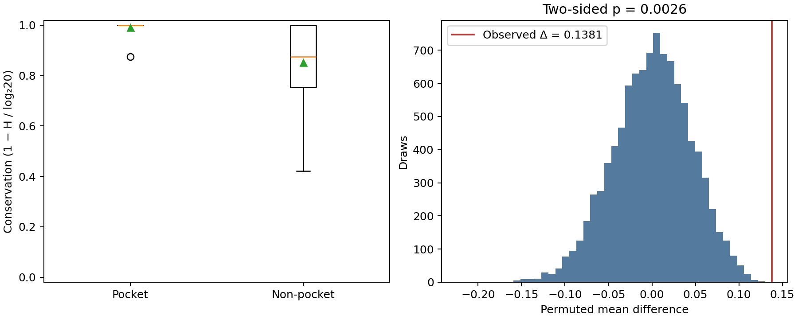
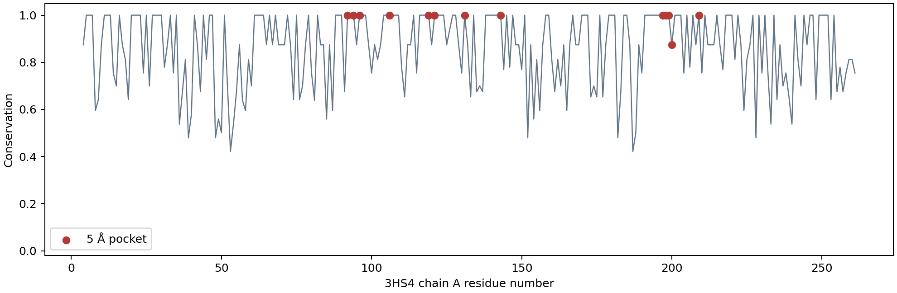

# Binding-pocket conservation across a protein family

Are ligand-contacting residues more conserved than other residues in a protein family? In this focused case study of **vertebrate carbonic anhydrase II (CA2)**, the acetazolamide-contacting pocket is more conserved than the other resolved residues of the human reference structure.

## Data and approach

The committed inputs are eight reviewed UniProt CA2 sequences from eight species and the experimental human CA2–acetazolamide structure [PDB 3HS4](https://www.rcsb.org/structure/3HS4). The exact UniProt query, download URLs, UTC retrieval times, file sizes and SHA-256 hashes are in [the provenance manifest](data/raw/provenance.json). [Sequence metadata](results/sequences.csv) lists every accession and species. Downloads can be refreshed separately; the default analysis uses the committed snapshots and verifies their hashes.

1. Retain canonical sequences of length 240–280, sort accessions and collapse exact sequence duplicates. All eight source sequences were retained and are distinct.
2. Use model 1, chain A, and select the AZM molecule closest to structural zinc. This matters because 3HS4 also contains two surface-bound AZM molecules. The selected AZM is residue A:701; its minimum heavy-atom distance to zinc is 1.9402 Å. Define pocket residues by minimum protein–ligand heavy-atom distance **≤5 Å**. Exclude waters, zinc and other heterogens from protein residues; use Bio.PDB's selected alternate conformers.
3. Align the eight family sequences plus the observed structure sequence using **conda-installed MAFFT 7.526**, `--auto --thread 1`. The structure sequence only maps alignment columns to actual PDB residue numbers and insertion codes; it is excluded from conservation estimates.
4. At each mapped column, exclude gaps and noncanonical symbols, compute Shannon entropy `H = −Σ p(a) log₂ p(a)` and conservation `C = 1 − H/log₂(20)`. Use equal weights per unique sequence and retain columns with ≥80% coverage. Higher C means greater conservation. Compare pocket residues against all other resolved chain-A residues passing that same filter.
5. Test the mean difference with 10,000 random residue-label permutations, preserving pocket size, seed 29. The two-sided p-value is `(1 + count(|null Δ| ≥ |observed Δ|))/(10000 + 1)`. Report 4 Å and 6 Å cutoffs as descriptive sensitivity analyses; 5 Å is the predefined primary analysis.

## Results

All **257/257** resolved canonical residues mapped once and passed the coverage filter.

| Primary 5 Å analysis | Value |
|---|---:|
| Unique sequences / source species | 8 / 8 |
| Pocket / non-pocket residues | 13 / 244 |
| Mean pocket conservation | 0.990325 |
| Mean non-pocket conservation | 0.852222 |
| Mean difference (pocket − non-pocket) | 0.138104 |
| Permutations | 10,000 |
| Two-sided permutation p-value | 0.00259974 |

The positive difference persists descriptively at 4 Å (11 residues, Δ=0.135143) and 6 Å (19 residues, Δ=0.119253). These results support stronger conservation of this inhibitor-contacting site **within this sampled CA2 set**, under a residue-label exchangeability null. They do not establish a family-wide evolutionary mechanism.





All values above come from [summary.json](results/summary.json) and [sensitivity.csv](results/sensitivity.csv). Detailed outputs:

- [Per-residue conservation, coverage, alignment mapping and ligand distance](results/residues.csv), [pocket residues](results/pocket.csv).
- [MAFFT alignment](results/alignment.fasta), [alignment input](results/input.fasta), [MAFFT log](results/mafft.log).
- [All 10,000 null differences](results/permutation_null.csv).
- [Predefined scope and acceptance criteria](docs/SCOPE.md).

## Reproduce

```bash
conda env create -f environment.yml
conda activate p29-pocket
pytest -q
PYTHONPATH=src python -m pocket_conservation
python scripts/verify_results.py
```

The analysis needs MAFFT on `PATH`. No network is required for tests or analysis. `verify_results.py` compares regenerated scientific results with `HEAD`, allowing numeric tolerance of 1e-8; both FASTA files must match exactly. It also verifies that both PNGs exist with valid signatures. GitHub Actions repeats these steps and uploads the generated outputs.

To deliberately fetch a new public snapshot (which may change the family sample and results):

```bash
python scripts/download_data.py
PYTHONPATH=src python -m pocket_conservation
```

Review source and result changes together and update this report before committing refreshed inputs. The environment file pins tool and library minor versions; the recorded execution versions are in `results/summary.json`.

## Limitations

- Eight reviewed sequences are a small convenience sample, unevenly distributed across vertebrates. Orthology is inferred from reviewed CA2 annotations rather than reconstructed gene trees. Phylogenetic weighting/correction: **not done**. Related sequences and spatially dependent residues violate simple independence/exchangeability assumptions; the p-value is an exploratory conditional comparison.
- Solvent-accessibility, secondary-structure and spatially matched null models: **not done**. The comparison can reflect burial or catalytic constraints as well as ligand contact.
- Only resolved residues of one human structure and one inhibitor-defined site are analyzed. Missing residues are excluded; this does not compare physical pockets across species. Cross-structure pocket similarity and de novo fpocket detection: **not done**. The original broad project idea was narrowed explicitly in the scope.
- Jensen–Shannon scoring, optional structure-coloring files and experimental validation: **not done**. Shannon entropy provides the requested conservation measure; neither activity nor binding affinity is predicted.

## Sources

- [RCSB 3HS4 deposition and ligand information](https://www.rcsb.org/structure/3HS4); [Sippel et al., 2009](https://doi.org/10.1107/S1744309109036665).
- [UniProt REST API documentation](https://www.uniprot.org/help/api_queries); exact query and original FASTA headers are archived with the inputs.
- [MAFFT documentation](https://mafft.cbrc.jp/alignment/software/manual/manual.html).
